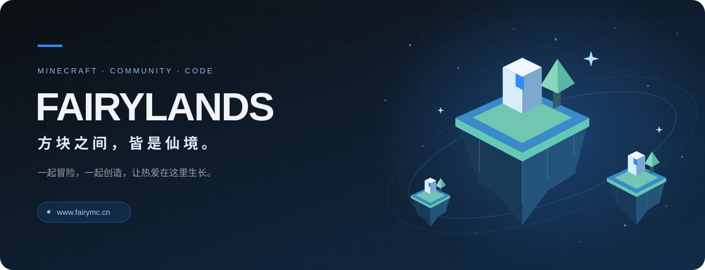

  

  <b>欢迎来到 Fairylands 仙境社区的开发空间。</b> 
  从游戏里的一次相遇，到代码里的一点巧思，我们一起把仙境变得更好。

  
  &nbsp;
  

 

## 在仙境，开启属于你的一局

打几场起床，来一局空岛，或者找个地方慢慢盖房子。玩法不同，相遇的快乐一样。

| 起床战争 · Bed Wars | 空岛战争 · Sky Wars | 生存世界 · Survival |
| :--- | :--- | :--- |
| 收集资源、守护床铺，与队友一起进攻和防守。 | 从一座小岛出发，搜集装备，搭桥迎战，留到最后。 | 挖矿、建家、研究红石，把脑海里的世界一块块搭出来。 |

 

## 游戏之外，也有你的同伴

**组队与闲聊** — 在官网的全服聊天室找队友、聊日常，也可以创建自己的群组。  
**记录与分享** — 在玩家论坛分享作品和经历，在仙境百科查攻略、补充自己的发现。  
**公平与守护** — 举报、申诉与违规公示均可从官网进入，让每一场对局都有认真对待它的人。

<a href="https://www.fairymc.cn/">前往官网，找到你的下一站 ↗</a>

 

## 让下一次冒险更好一点

这里是 **FairyMCDev**。我们用代码连接游戏与社区，也欢迎你参与其中。

- **发现问题？** 到对应项目的 Issues 留下复现步骤、运行环境与必要日志。
- **有个好点子？** 在对应项目提出建议，聊聊它能为玩家带来什么。
- **想动手实现？** 先阅读项目说明与贡献要求，再提交你的 Pull Request。

每一次修复、每一条建议、每一份分享，都能成为仙境的一部分。

 

---

  FAIRYLANDS · 仙境社区 
  在方块世界相遇，在创造中同行。  
  <a href="https://www.fairymc.cn/">官方网站</a> · <a href="https://github.com/orgs/FairyMCDev/repositories">项目仓库</a>

